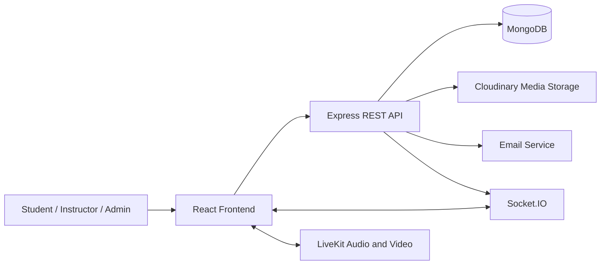

# DevStream Nexus Presentation Script

## Presentation Goal

This document is a speaking script and slide plan for demonstrating DevStream Nexus.

**Recommended presentation length:** 10-15 minutes

**Main message:** DevStream Nexus is a developer-focused collaboration platform where students can learn, build projects, communicate, get support, share work, and participate in live technical sessions.

---

## 1. Title Slide

### Slide content

**DevStream Nexus**

A collaborative platform for learning, building, streaming, and support.

### What to say

"Good morning/afternoon. My project is DevStream Nexus, a developer-oriented collaboration platform. The goal is to bring several activities that students and developers commonly need into one system: project collaboration, real-time communication, live technical streaming, support tickets, hiring, and digital products."

---

## 2. Problem Statement

### Slide content

- Students use separate tools for projects, communication, support, and learning.
- Project collaboration becomes difficult to organize.
- Support requests are difficult to track through a simple chat.
- Live technical learning needs controlled access and moderation.
- Users need one place to present their profile, projects, skills, and work.

### What to say

"The problem I wanted to address is fragmentation. A student may use one platform for messaging, another for project management, another for support, and another for live learning. This makes information difficult to follow and creates duplicated workflows. DevStream Nexus combines these workflows into one role-based platform."

---

## 3. Proposed Solution

### Slide content

DevStream Nexus provides:

- User authentication and profiles
- Project collaboration
- Real-time messaging
- Support ticket workflow
- Live audio/video rooms
- Hiring and applications
- Marketplace products
- Notifications and activity history

### What to say

"The proposed solution is a single web application with a React frontend and a Node.js backend. The backend is responsible for authentication, authorization, persistence, business rules, and secure integrations. The frontend provides the user experience for students, instructors, and administrators."

---

## 4. Users and Roles

### Slide content

### Student

- Create and join projects
- Send messages
- Create support tickets
- Join public or authorized private streams
- Apply for opportunities
- Buy marketplace products

### Instructor

- Manage support tickets
- Claim and resolve student requests
- Participate in project and stream workflows
- Communicate with students

### Administrator

- Manage users and projects
- Review audit logs
- Moderate streams
- Manage support operations
- Perform protected administrative actions

### What to say

"The application uses role-based behavior. A student, instructor, and administrator do not see or perform exactly the same actions. Authorization is enforced on the backend, not only by hiding buttons in the frontend."

---

## 5. Technology Stack

### Frontend

- React 19
- Vite
- React Router
- Axios
- Socket.IO client
- LiveKit client
- Lucide React icons
- Custom responsive CSS

### Backend

- Node.js with ES modules
- Express 5
- MongoDB with Mongoose
- Socket.IO
- LiveKit server SDK
- Cloudinary
- JWT and HTTP-only cookies
- Passport OAuth
- Multer for uploads
- Helmet and CORS
- Nodemailer for email workflows

### What to say

"React and Vite are used for the client application. Express and MongoDB provide the API and persistence layer. Socket.IO provides realtime events, while LiveKit provides the actual audio and video infrastructure. Cloudinary is used for uploaded media."

### Evidence in the repository

- [Frontend/package.json](Frontend/package.json)
- [Backend/package.json](Backend/package.json)
- [Backend/server.js](Backend/server.js)

---

## 6. System Architecture



### What to say

"The normal CRUD operations use REST APIs. Data such as users, projects, tickets, messages, streams, participants, and purchases are stored in MongoDB. Realtime changes use Socket.IO. Live audio and video use LiveKit rather than being implemented manually in the application."

---

## 7. MVP Definition

### MVP statement

The MVP is a working platform that demonstrates the core learning and collaboration loop:

1. A user can authenticate.
2. A user can create or view a profile.
3. A user can create or participate in a project.
4. Users can communicate through messages and attachments.
5. A student can create a support ticket.
6. An instructor can claim the ticket, reply, and move it through its workflow.
7. An authorized user can create, join, and manage a live stream.
8. Important changes are persisted and selected changes are delivered in realtime.

### MVP versus extended platform

The MVP focuses on authentication, profiles, projects, messaging, support, and the core streaming lifecycle.

The extended platform also includes hiring, marketplace products, purchases, wallets, withdrawals, reviews, notifications, moderation, analytics, and admin operations.

### MVP limitations to state honestly

- Streaming is ephemeral; recording and playback are not part of the current MVP.
- Permission request and approval infrastructure exists, but the complete permission UI is not the main MVP path.
- Screen-share audio is supported by LiveKit but is not fully persisted in the MongoDB permission model.
- Bandwidth adaptation and stream replay are future enhancements.
- External services require valid environment variables and network access.

### What to say

"For the MVP, I intentionally focused on the end-to-end user journey rather than claiming that every possible platform feature is complete. The demo will show the core journey working from authentication and collaboration to support and realtime communication."

---

## 8. Main Feature: Authentication and Profiles

### Demonstrate

1. Open the login page.
2. Show login and registration tabs.
3. Explain role-aware access.
4. Open a profile.
5. Show avatar, cover image, biography, skills, projects, and contact links.
6. Show that another public profile can expose its configured contact links such as email, GitHub, LinkedIn, or portfolio.

### What to say

"Authentication protects the application and establishes the user's identity. The profile acts as a developer identity page where users can present their skills, projects, and contact links. Sensitive credentials are not included in public profile responses."

### Technical points

- JWT authentication
- Refresh-token support
- HTTP-only cookies
- Password reset flow
- Google and GitHub OAuth configuration
- Role and account-status middleware

---

## 9. Main Feature: Projects

### Demonstrate

1. Open Projects.
2. Use search and filters.
3. Open a project.
4. Show project name, description, technologies, status, visibility, members, and activity.
5. Show project cover image and logo.
6. Show partnership actions if the account has permission.
7. Show project-linked jobs if available.

### What to say

"Projects are the main collaboration unit. They have an owner, optional co-owners, members, technologies, lifecycle status, visibility, images, activity history, partnership requests, and potentially linked jobs."

### Technical points

- Owner and co-owner authorization
- Public/private visibility
- Image uploads through Multer and Cloudinary
- Project activity records
- Filtered project listing
- Functional local pagination in the project list

---

## 10. Main Feature: Realtime Messaging

### Demonstrate

1. Open Messages.
2. Select a conversation.
3. Send a normal message.
4. Attach an image.
5. Show the local image preview before sending.
6. Send the image and show the inline image in the chat.
7. Click the image and show the centered in-page preview.
8. Use Reply and show the quoted message context.
9. Use Code block and show the formatted code bubble.
10. Delete a message if appropriate.

### What to say

"Messaging supports normal text, image attachments, code formatting, message actions, and realtime updates. Images are uploaded to Cloudinary and displayed inline rather than as an inconvenient filename-only link."

### Technical points

- Socket.IO `newMessage` event
- Multipart uploads with Multer
- File validation by extension and MIME type
- Cloudinary storage
- Inline image previews
- In-page lightbox preview
- Code blocks rendered with `pre` and `code`
- Reply context in the composer

---

## 11. Main Feature: Support Workflow

### Demonstrate

1. Log in as a student.
2. Create or open a support ticket.
3. Show title, description, priority, course, and lesson.
4. Log in or switch to an instructor account.
5. Open the instructor queue.
6. Claim the ticket.
7. Open ticket details.
8. Send a reply.
9. Attach an image or file to a reply.
10. Change status.
11. Show the workflow timeline update without a page reload.
12. Return to the student view and show the updated message/status.

### Workflow

```text
Open -> Claimed -> In Progress -> Waiting For Student -> Resolved -> Closed
```

### What to say

"The support module is more than a chat box. A ticket has a controlled backend workflow and an audit-style timeline. Students and instructors can communicate in the ticket conversation, attach files, and see status changes in realtime."

### Technical points

- SupportTicket model
- Conversation reused for support messages
- Status transitions enforced by the backend
- Status history stored on the ticket
- Socket.IO message updates
- Socket.IO support status updates
- Instructor assignment and queue management
- Closed tickets become read-only where required

### Supported reply attachments

- Images
- PDF files
- ZIP files
- Common text and code files

---

## 12. Main Feature: Live Streaming

### Demonstrate

1. Open Live Rooms.
2. Create a stream.
3. Choose public or private visibility.
4. Start the stream explicitly.
5. Join the room from another account if possible.
6. Show audio/video state.
7. Show participant presence.
8. Demonstrate chat or moderation if time allows.
9. Leave the room.
10. End the stream explicitly as the host.

### What to say

"Live streaming uses LiveKit for audio and video. Socket.IO handles application-level realtime events such as presence, chat, participant changes, permission changes, and moderation. The backend remains authoritative for who can join and what permissions they receive."

### Stream lifecycle

```text
Scheduled -> Started -> Ended
```

### Technical points

- LiveKit room connection
- Server-generated access tokens
- Token identity comes from the authenticated user
- Public/private stream access checks
- Host, speaker, and viewer roles
- Kick and ban operations
- Host presence heartbeat
- Atomic stream lifecycle updates
- Room cleanup when a stream ends
- Viewer and peak-viewer statistics

---

## 13. Security and Reliability Work

### Slide content

- Backend authorization
- JWT-authenticated sockets
- Server-controlled LiveKit identity
- Private stream access checks
- Ban and kick enforcement
- Atomic participant upserts
- Unique stream/user participant constraint
- File extension and MIME validation
- Upload size and count limits
- Helmet and CORS configuration
- Sanitized message content
- Signed LiveKit webhook handling

### What to say

"A major part of the implementation was making state changes reliable and secure. For example, the client cannot simply claim to be another user when requesting a LiveKit token. The server uses the authenticated identity. Participant joins use atomic operations so concurrent requests do not create duplicate records."

### Streaming hardening highlights

- Explicit start and end transitions
- No automatic stream end merely because the host disconnects
- Atomic participant join and rejoin handling
- Ban checks during joining
- Permission synchronization with rollback handling
- Authenticated and rate-limited socket events

Reference: [PROJECT_COMPLETION_SUMMARY.md](PROJECT_COMPLETION_SUMMARY.md)

---

## 14. Installation and Setup

### Prerequisites

- Node.js
- npm
- MongoDB
- Cloudinary account
- LiveKit account or server
- Optional Google OAuth credentials
- Optional GitHub OAuth credentials
- Optional SMTP/email credentials

### Backend setup

```bash
cd Backend
npm install
npm run dev
```

### Frontend setup

```bash
cd Frontend
npm install
npm run dev
```

### Required configuration categories

Backend environment variables should provide:

```text
MONGODB_URI
JWT_SECRET
CLIENT_URL
CLOUDINARY_CLOUD_NAME
CLOUDINARY_API_KEY
CLOUDINARY_API_SECRET
LIVEKIT_URL
LIVEKIT_API_KEY
LIVEKIT_API_SECRET
```

OAuth and SMTP variables are required only if those integrations are demonstrated.

### What to say

"The frontend and backend are separate npm applications. The backend connects to MongoDB and external services. The frontend calls the backend through Axios. Before the demo, I verify the environment variables, start the backend, start the frontend, and test login, upload, messaging, support, and LiveKit connectivity."

---

## 15. Suggested Live Demo Order

Use this order if time is limited:

1. Login
2. Open a profile
3. Open Projects and show a project
4. Send a message with an image
5. Open the image inline
6. Create a support ticket
7. Reply from an instructor account
8. Change the ticket status
9. Show the realtime timeline update
10. Create and join a live stream
11. Explain marketplace and hiring as additional modules

### Demo fallback order

If external LiveKit or Cloudinary services fail:

1. Continue with authentication and profiles.
2. Demonstrate project forms and local preview.
3. Demonstrate support workflow and database-backed status changes.
4. Demonstrate normal text messaging.
5. Explain that the external integration needs its environment credentials.

Do not pretend an external service is working if it is not connected.

---

## 16. Likely Questions and Answers

### Q1. What problem does the project solve?

**Answer:** It reduces fragmentation by combining developer profiles, projects, messaging, support, live learning, hiring, and digital products in one role-based platform.

### Q2. Who are the target users?

**Answer:** Students, instructors, developers, project collaborators, marketplace buyers and sellers, and administrators.

### Q3. What is the MVP?

**Answer:** Authentication, profiles, project collaboration, realtime messaging, support ticket workflow, and the core LiveKit stream lifecycle. The marketplace and hiring modules extend the MVP.

### Q4. Why did you separate frontend and backend?

**Answer:** It separates presentation from business rules and data access. The backend can enforce authorization consistently for web or future clients, while the React frontend focuses on user interaction.

### Q5. Why use MongoDB?

**Answer:** The application contains flexible domain objects such as profiles, projects, messages, tickets, streams, participant records, and activity histories. Mongoose provides schemas, validation, relationships, and indexed queries.

### Q6. Why use Socket.IO?

**Answer:** REST is suitable for persistence, but Socket.IO is suitable for pushing events such as new messages, status changes, presence, typing, participant changes, and moderation updates without polling or reloading.

### Q7. Why use LiveKit instead of building WebRTC manually?

**Answer:** LiveKit provides a proven realtime media layer with room management and track permissions. The project focuses on application authorization and workflow while relying on a specialized media system for audio and video.

### Q8. How is a private stream protected?

**Answer:** The backend checks the user's identity and access before issuing a LiveKit token. A client cannot choose another identity because the token identity is derived from the authenticated server user.

### Q9. How do you prevent duplicate stream participants?

**Answer:** Stream participation uses a unique stream/user relationship and atomic upsert operations. Rejoining updates the existing record and increments join tracking instead of creating another participant record.

### Q10. What happens when a user is banned?

**Answer:** The backend checks the ban before allowing access or issuing a token. The host can also kick participants, and the participant history is preserved where appropriate.

### Q11. How does support status remain synchronized?

**Answer:** The status is saved by the backend, added to status history, and broadcast through Socket.IO. The open ticket page consumes the event and updates its ticket state and timeline immediately.

### Q12. How are messages stored?

**Answer:** Messages are stored in MongoDB with their conversation, sender, content, read state, deletion state, and optional attachment metadata.

### Q13. How are images stored?

**Answer:** The browser sends multipart data to the backend. Multer receives and validates the file in memory, then Cloudinary stores the media. The database stores the secure URL and public ID.

### Q14. How do you validate uploaded files?

**Answer:** The upload middleware checks extensions and MIME types, and the validator checks file size and content metadata. Upload count and size limits are also enforced by Multer.

### Q15. What security measures did you implement?

**Answer:** JWT authentication, HTTP-only cookies, role middleware, account-status checks, authenticated sockets, server-controlled LiveKit identities, private-stream authorization, ban checks, input sanitization, file validation, Helmet, CORS, rate limiting, and signed webhook verification.

### Q16. What is realtime and what is not realtime?

**Answer:** Messages, selected support status changes, stream chat, participant updates, presence, and moderation events use realtime events. Initial page loading and many ordinary CRUD operations still use REST requests.

### Q17. What happens if two people join at the same time?

**Answer:** Atomic database operations and unique constraints prevent duplicate participant records and protect viewer statistics from race-condition inflation.

### Q18. What are the current limitations?

**Answer:** The MVP does not include recording or playback, complete permission UI, bandwidth adaptation, or stream replay. OAuth, email, Cloudinary, MongoDB, and LiveKit also require valid external configuration.

### Q19. How would you improve the project next?

**Answer:** I would complete the permission request UI, add stream recording and replay, add analytics dashboards, add Redis for horizontally scaled Socket.IO, add CDN optimization, and improve marketplace integration and testing.

### Q20. How did you test the project?

**Answer:** I used backend Node tests for security utilities and repository diagnostics/build checks for frontend changes. I also tested the main flows manually: authentication, project forms, uploads, messaging, support workflow, realtime status updates, and stream operations.

### Q21. Why are some features shown as unavailable?

**Answer:** The project distinguishes the working MVP from future features. It is better to give clear feedback for a feature outside the current scope than to present a button that silently fails.

### Q22. What is the most technically difficult part?

**Answer:** Keeping realtime state, database state, and LiveKit state consistent. This required server-authoritative permissions, atomic participant operations, lifecycle validation, event synchronization, and cleanup on stream end.

### Q23. Can the system scale?

**Answer:** The current design provides a foundation for scaling through database indexes, atomic operations, and Socket.IO. For multiple backend instances, Redis pub/sub or a Socket.IO Redis adapter would be added.

### Q24. What would happen if MongoDB or Cloudinary goes offline?

**Answer:** The affected operation fails and the UI should show an error. The platform should not claim that an upload or database mutation succeeded when the external dependency failed. A production version would add retries, health checks, and stronger observability.

---

## 17. Closing Slide

### Slide content

**DevStream Nexus**

- One platform for learning and collaboration
- Secure role-based workflows
- Realtime communication and support
- Live technical streaming
- Extensible architecture for future features

### What to say

"To conclude, DevStream Nexus demonstrates how a modern full-stack application can combine persistent workflows with realtime interaction. The MVP provides a practical collaboration and support journey, while the architecture leaves room for streaming analytics, recording, stronger marketplace integration, and additional learning features. Thank you."

---

## 18. Final Presentation Checklist

### Before the presentation

- [ ] Start MongoDB.
- [ ] Confirm backend environment variables.
- [ ] Confirm frontend API URL.
- [ ] Confirm Cloudinary credentials if demonstrating uploads.
- [ ] Confirm LiveKit credentials if demonstrating streaming.
- [ ] Start the backend with `npm run dev`.
- [ ] Start the frontend with `npm run dev`.
- [ ] Test login with a student account.
- [ ] Test login with an instructor/admin account.
- [ ] Test one image upload.
- [ ] Test one support reply.
- [ ] Test one realtime status update.
- [ ] Test browser camera and microphone permissions.
- [ ] Prepare a fallback demo if an external service is unavailable.

### During the presentation

- [ ] Explain the problem before showing screens.
- [ ] Identify the MVP clearly.
- [ ] Show one complete user journey.
- [ ] Explain which events are realtime.
- [ ] Mention security at the point where it is demonstrated.
- [ ] Be honest about limitations.
- [ ] Leave time for questions.
